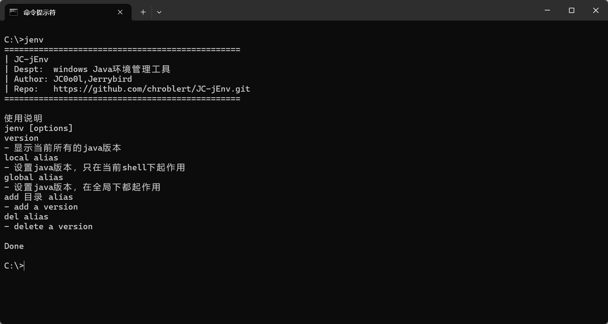
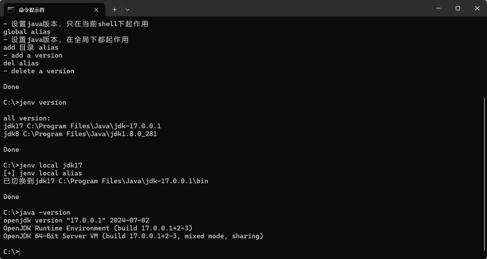

# jenv

Windows 下的 Java 多版本切换工具：一条命令，在同一个 cmd 窗口里切换 JDK。

> 基于 [JC-jEnv](https://github.com/chroblert/JC-jEnv.git)（Author: JC0o0l, Jerrybird）。
> 本机版本修复了 Unix 换行符导致的解析错误、含空格路径（`C:\Program Files\Java`）处理、以及中文输出乱码问题。

## 效果

`jenv` —— 查看帮助



`jenv version` / `jenv local jdk17` / `java -version`



## 快速开始

1. 把脚本目录加入 PATH（或直接在脚本目录下执行 `jenv.bat`）
2. 注册本机 JDK，路径含空格时用引号包起来：

```bat
jenv add "C:\Program Files\Java\jdk1.8.0_281" jdk8
jenv add "C:\Program Files\Java\jdk-17.0.0.1" jdk17
```

## 命令

| 命令 | 说明 |
| --- | --- |
| `jenv` | 显示帮助 |
| `jenv version` | 列出所有已注册版本，`*` 标记当前版本 |
| `jenv local <alias>` | 只在当前 cmd 窗口生效，立刻用 `java -version` 可验证 |
| `jenv global <alias>` | 写注册表，新开窗口后对 JAVA_HOME 生效 |
| `jenv add <目录> <alias>` | 注册一个版本 |
| `jenv del <alias>` | 删除一个版本 |

切换示例（同一个窗口内来回切）：

```bat
jenv local jdk17 && java -version
jenv local jdk8  && java -version
```

## 原理

- **别名就是环境变量**：`jenv add` 用 `setx` 在 `HKCU\Environment` 写入 `jdk8 = C:\Program Files\Java\jdk1.8.0_281`，并把所有别名记在 `JC_jEnv` 里（分号分隔），`jenv version` 遍历它。
- **local**：把 `<JDK>\bin` 前插到当前 cmd 进程的 PATH —— Windows 按 PATH 从前往后查找 `java.exe`，命中即停，所以新路径优先于系统里已有的旧 java；同时设置会话级 `JAVA_HOME`。窗口关闭即失效。
- **global**：用 `setx` / `reg add` 把 `JAVA_HOME` 写进注册表，供之后新开的进程读取。

## 注意

- PATH 里不要出现具体 java 路径，推荐使用 `%JAVA_HOME%\bin`；系统变量里的 `JAVA_HOME` 请删除（脚本只改用户变量，需要管理员权限的系统变量不在处理范围内）。
- 脚本保存为 **GBK 编码 + CRLF 换行**（cmd 批处理的硬性要求）。用编辑器修改后若变成 LF 换行或 UTF-8 编码，会出现 `此时不应有 |` 之类的解析错误。
